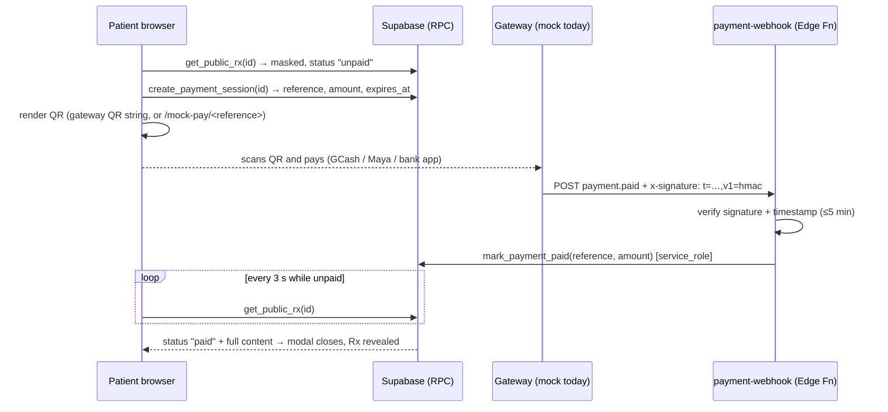

# Payment flow

## Mock gateway (current)
`mock-gateway` plays the gateway: it looks up the payment, builds a `payment.paid` event, signs it with
`PAYMENT_WEBHOOK_SECRET` and POSTs it to `payment-webhook`. The browser never marks anything paid itself.
Anyone who knows a payment reference could trigger it, which is why it is gated by `MOCK_GATEWAY_ENABLED`.

## Switching to a real gateway (PayMongo / Xendit / Stripe)
1. **Create the QR** — extend `create_payment_session` flow with an Edge Function (`create-payment`) that calls the
   gateway (e.g. PayMongo/Xendit **QR Ph**), then stores the returned QR string in `payments.qr_payload`
   and `payments.gateway`. The client already renders `qr_payload` when present.
2. **Verify webhooks** — in `payment-webhook/index.ts` replace `verifySignature` / `parseEvent` with the gateway's scheme
   (PayMongo: `Paymongo-Signature`, Xendit: `x-callback-token`, Stripe: `Stripe-Signature`). Map the gateway's
   “paid” event to `mark_payment_paid(reference, amount)`.
3. Set `VITE_PAYMENT_MODE=live`, delete `mock-gateway`, unset `MOCK_GATEWAY_ENABLED`.
4. Register the webhook URL `https://<ref>.supabase.co/functions/v1/payment-webhook` in the gateway dashboard.

`mark_payment_paid` is idempotent and re-checks the amount, so duplicate or replayed events are harmless.
