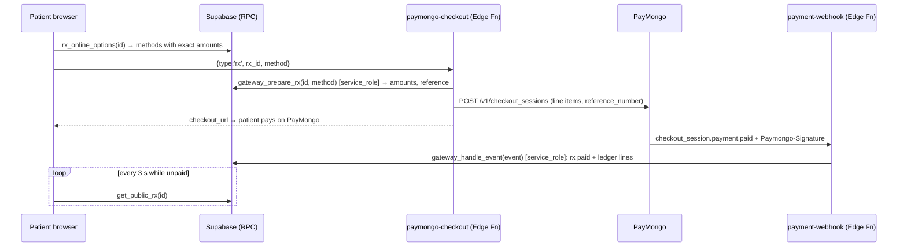

# Payment flow (PayMongo)

ODYSSEY collects online payments through its own PayMongo account, as the doctors' collecting agent.
Migration `0010_paymongo_gateway.sql` holds all the rules; the Edge Functions only talk to PayMongo.

## Money rules
- **Fees** (`gateway_fee_rates`, editable in Admin → Money and payouts → Fees and rules): ODYSSEY's all-in fee per method,
  and PayMongo's charge with VAT as an estimate. The real PayMongo charge (amount − net amount) is stored with each payment.
- **Who pays the fee** is each doctor's choice: `pass` adds it on top (doctor gets the full fee), `absorb` takes it from the share.
- **Plans, seats and packs** are paid online too; ODYSSEY absorbs PayMongo's charge.
- **Ledger** (`ledger_entries`) is append-only. Accounts: `doctor`, `odyssey_fee`, `odyssey_sales`, `paymongo_cost`,
  `payout_fee`, `suspense`. Every balance on every screen is a sum of lines. The sum of all lines is the money that
  should be with PayMongo before ODYSSEY's own withdrawals.
- **Hold**: a doctor's share is available after `hold_days` (default 7).
- **Payouts**: doctor asks (`request_payout`, money leaves the balance at once) → admin sends from the admin page
  (`paymongo-ops` → `POST /v2/batch_transfers` with an Idempotency-Key) → `transfer.outward.successful|failed` webhook.
  A failure, rejection or cancellation puts the money back with a new ledger line.
- **Refunds** (admin): fees are not refunded. A prescription refunds its price from the doctor's balance; a purchase
  refunds what was paid; money held aside refunds in full. QR Ph refunds use `refunds-api.paymongo.com` and return a claim link.
- **Held aside** (`needs_review` + `suspense`): a wrong amount, a second payment for a paid prescription, or a purchase
  that cannot be applied. Nothing is lost; the admin refunds it, or approves the purchase in Payments to verify.

## PayMongo webhook
URL: `https://<project-ref>.supabase.co/functions/v1/payment-webhook` (one per mode: test and live).
Events: `checkout_session.payment.paid`, `payment.failed`, `payment.refunded`, `payment.refund.updated`,
`transfer.outward.successful`, `transfer.outward.failed`, `payout.deposited`, `payout.returned`.

## Secrets (`supabase/functions/.env`, never in `client/.env`)
`PAYMONGO_SECRET_KEY`, `PAYMONGO_PUBLIC_KEY`, `PAYMONGO_WEBHOOK_SECRET`, `APP_URL`, and optionally
`PAYMONGO_SOURCE_ACCOUNT_NUMBER|NAME|BIC` (the wallet payouts are sent from; otherwise read from `GET /v2/wallets`).

## Manual fallback
Admin → Fees and rules → "Also allow QR and receipt" brings back the old receipt flows (for PayMongo outages).
