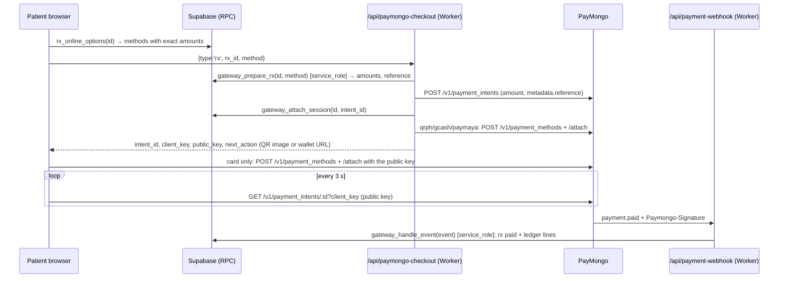

# Payment flow (PayMongo)

ODYSSEY collects online payments through its own PayMongo account, as the doctors' collecting agent.
Migration `0010_paymongo_gateway.sql` holds all the rules; the Cloudflare Worker (`worker/src`, `/api/*`) only talks to PayMongo.

Payments happen on our own pages (PayMongo Payment Intents), not on PayMongo's hosted checkout page:
QR Ph shows the QR in the page, cards use a card form in the page (card details go from the browser straight to
PayMongo with the public key; the bank's 3-D Secure check opens in a frame), and GCash / Maya open their approval
page in a small window over ours (a full-page redirect if the browser blocks it). `public/pay-done.html` is the
return page for the frame and the window.

## Money rules
- **Fees** (`gateway_fee_rates`, editable in Admin → Money and payouts → Fees and rules): ODYSSEY's all-in fee per method,
  and PayMongo's charge with VAT as an estimate. The real PayMongo charge (amount − net amount) is stored with each payment.
- **Who pays the fee** is each doctor's choice: `pass` adds it on top (doctor gets the full fee), `absorb` takes it from the share.
- **Plans, seats and packs** are paid online too; ODYSSEY absorbs PayMongo's charge.
- **Ledger** (`ledger_entries`) is append-only. Accounts: `doctor`, `odyssey_fee`, `odyssey_sales`, `paymongo_cost`,
  `payout_fee`, `suspense`. Every balance on every screen is a sum of lines. The sum of all lines is the money that
  should be with PayMongo before ODYSSEY's own withdrawals.
- **Weekly cycle** (migrations 0018, 0019): PayMongo settles to ODYSSEY's wallet every Thursday. A doctor's share of a
  payment made Monday to Sunday (Manila) becomes available on the Saturday after (`payout_saturday()`; `hold_days` adds
  extra days, 0 by default).
- **Automatic payouts**: the Worker cron (`*/15 * * * *`, `worker/src/cron.ts`) runs, for 72 hours from Saturday 00:00
  Manila, `cron_prepare_weekly_payouts()` (one payout per doctor for everything available, at least `min_payout`; a
  rejected one is retried after 2 hours, at most 3 times a week), then sends those whose account name matches the verified
  doctor, while the PayMongo Wallet covers them. Name mismatches wait in Admin → Money → Payouts. PayMongo does not check
  payout bank accounts.
- **Digital tax** (0.5% under RR 5-2025): PayMongo keeps it when it settles to the wallet. Each tick the cron reads
  `GET /v1/payouts` and records `amount − net − fee − refunds − disputes` per payout in `paymongo_deductions` (anything over
  1.6% of a payout is logged for a person instead). An admin can add or remove one by hand. Each is a line on the
  `withholding_tax` account. Doctors bear it on their share: each prescription payment moves `withholding_pct` of the share
  from the doctor to that account, so its balance is ODYSSEY's own part (a credit on ODYSSEY's BIR 2307).
- **Payouts**: prepared on Saturday (money leaves the balance at once) → sent by the cron, or by an admin from the admin page
  (`paymongo-ops` → `POST /v2/batch_transfers` with an Idempotency-Key) → `transfer.outward.successful|failed` webhook.
  A failure, rejection or cancellation puts the money back with a new ledger line.
- **Refunds** (admin): fees are not refunded. A prescription refunds its price from the doctor's balance; a purchase
  refunds what was paid; money held aside refunds in full. QR Ph refunds use `refunds-api.paymongo.com` and return a claim link.
- **Held aside** (`needs_review` + `suspense`): a wrong amount, a second payment for a paid prescription, or a purchase
  that cannot be applied. Nothing is lost; the admin refunds it, or approves the purchase in Payments to verify.

## PayMongo webhook
URL: `https://<your-site>/api/payment-webhook` (one per mode: test and live).
The Worker passes `payment.paid` on as `checkout_session.payment.paid`, matched by the intent id that
`gateway_attach_session` stored, so the database rules did not change. `checkout_session.payment.paid` is still
understood for hosted checkouts opened before the switch.
Events: `payment.paid`, `payment.failed`, `payment.refunded`, `payment.refund.updated`,
`transfer.outward.successful`, `transfer.outward.failed`, `payout.deposited`, `payout.returned`.

## Secrets (Worker secrets via `wrangler secret put`, `.dev.vars` locally; never in `client/.env`)
`SUPABASE_URL`, `SUPABASE_ANON_KEY`, `SUPABASE_SERVICE_ROLE_KEY`, `PAYMONGO_SECRET_KEY`, `PAYMONGO_PUBLIC_KEY`, `PAYMONGO_WEBHOOK_SECRET`, `APP_URL`, and optionally
`PAYMONGO_SOURCE_ACCOUNT_NUMBER|NAME|BIC` (the wallet payouts are sent from; otherwise read from `GET /v2/wallets`).

## Manual fallback
Admin → Fees and rules → "Also allow QR and receipt" brings back the old receipt flows (for PayMongo outages).
